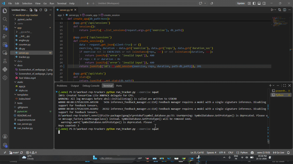
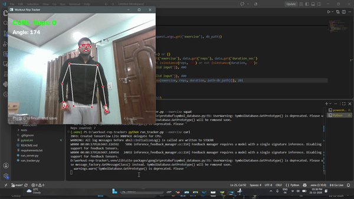
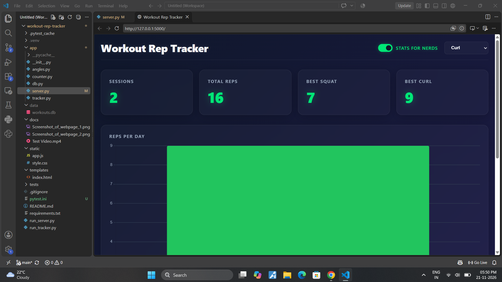
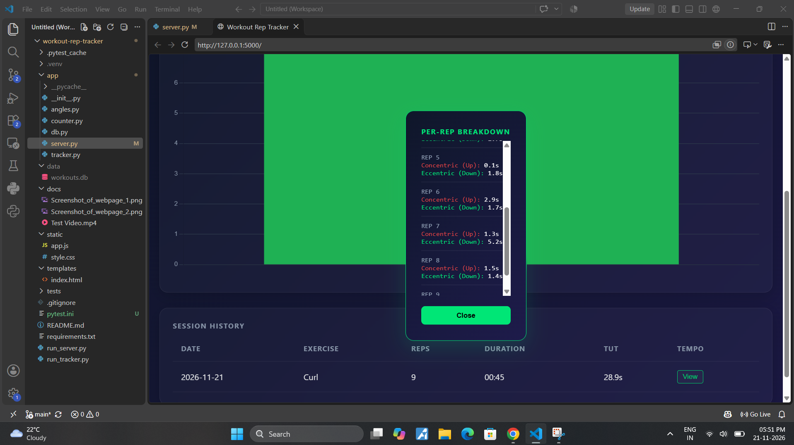

# Workout Rep Tracker

A Python computer vision application that uses a webcam to track body joints in real time, counts exercise reps across 5 lifts, measures Time Under Tension (TUT) and per-rep tempo, and saves workout history to a local SQLite database with an interactive web dashboard.

## Live Tracking Demos

| Squat Tracking | Bicep Curl Tracking |
| :---: | :---: |
|  |  |

## Features
- **Real-Time Pose & Rep Tracking:** Uses MediaPipe Pose and OpenCV to extract 2D body landmarks, compute live joint angles, and count reps with an on-screen overlay across **5 exercises**: Squat, Bench Press, Deadlift, Push-up, and Bicep Curl.
- **3-State Machine & Tempo Analytics:** Tracks transitions through `extended`, `moving_to_flex`, and `flexed` states to calculate total Time Under Tension (TUT) and log per-rep eccentric vs. concentric phase durations.
- **SQLite Persistence & Flask REST API:** Automatically saves finished sessions (exercise, reps, duration, TUT, JSON-serialized per-rep tempos, and timestamp) to a local SQLite database.
- **Interactive Glassmorphism Dashboard:** Web UI powered by vanilla JavaScript and Chart.js featuring session history, totals, dynamic exercise-based chart filtering, and an on-demand **"Stats for Nerds"** toggle with a modal breakdown of per-rep contraction and relaxation times.
- **Automated Testing:** Unit and API integration test suite built with `pytest` covering angle geometry, state-machine transitions, SQLite persistence, and Flask endpoints.

## Dashboard & Tempo Analytics





## Tech Stack
- **Language:** Python 3.10+
- **Video & Vision:** OpenCV (`opencv-python`), MediaPipe Pose
- **Database:** SQLite (`sqlite3`)
- **Backend:** Flask
- **Frontend:** HTML, CSS, vanilla JavaScript, Chart.js
- **Testing:** pytest

## Setup & Execution
1. Clone the repository and navigate to the project directory:
   ```bash
   git clone [https://github.com/Mukul0121/workout-rep-tracker.git](https://github.com/Mukul0121/workout-rep-tracker.git)
   cd workout-rep-tracker
   ```
2. Create and activate a virtual environment:
   ```bash
   python -m venv .venv
   # macOS / Linux
   source .venv/bin/activate
   # Windows PowerShell
   .\.venv\Scripts\activate
   ```
3. Install dependencies:
   ```bash
   pip install -r requirements.txt
   ```
4. Run the live webcam tracker (press `Q` to end and save the session):
   ```bash
   python run_tracker.py --exercise squat
   # Supported exercises: squat, bench, deadlift, pushup, curl
   ```
5. Run the web server (dashboard available at `http://127.0.0.1:5000`):
   ```bash
   python run_server.py
   ```
6. Run the automated test suite:
   ```bash
   pytest
   ```

## How Rep Counting & Tempo Work
Each exercise maps to three body landmarks (e.g., Hip–Knee–Ankle for squats, Shoulder–Hip–Knee for deadlifts, Shoulder–Elbow–Wrist for curls, bench press, and push-ups) and two angle thresholds (`extended` and `flexed`).

A 3-state machine monitors the live joint angle to prevent double-counting from minor jitter while timing each movement phase:
1. **`extended` → `moving_to_flex`:** Triggered when the joint angle drops below the extended threshold, recording the phase start timestamp.
2. **`moving_to_flex` → `flexed`:** Triggered when the joint angle passes the flexed threshold, logging the midpoint timestamp.
3. **`flexed` → `extended`:** Returning past the extended threshold registers one completed rep, records both eccentric and concentric durations for that rep, and adds to the session's total Time Under Tension (TUT).

## Project Structure
```text
workout-rep-tracker/
├── app/
│   ├── __init__.py
│   ├── angles.py        # Pure math: angle between three points
│   ├── counter.py       # Exercise config + 3-state RepCounter & tempo logic
│   ├── tracker.py       # Webcam loop, pose detection, overlay
│   ├── db.py            # SQLite schema & queries (sessions, TUT, rep tempos)
│   └── server.py        # Flask app and REST API routes
├── templates/
│   └── index.html       # Dashboard page & tempo breakdown modal
├── static/
│   ├── style.css        # Glassmorphism UI & Nerd Mode toggle styles
│   └── app.js           # Dynamic Chart.js filtering & tempo modal logic
├── tests/
│   ├── test_angles.py
│   ├── test_counter.py
│   ├── test_db.py
│   └── test_api.py
├── data/                # SQLite database (gitignored)
├── docs/                # Demo GIFs and dashboard screenshots
├── run_tracker.py       # Entry point for live tracker
├── run_server.py        # Entry point for Flask server
├── pytest.ini           # Pytest pythonpath configuration
├── requirements.txt
├── .gitignore
└── README.md
```